# nscad-lib

Kleine OpenSCAD-Bibliothek mit Abkürzungen und Bauteilen für ein **7,5-mm-Lochraster** mit M3-Bohrungen.

```openscad
use <nscad-lib.scad>
```

Alle Bilder wurden mit OpenSCAD aus den Dateien im Ordner [`examples/`](examples) erzeugt.

**Inhalt:** [Utils](#utils) · [Raster & Balken](#raster--balken) · [Boxen & Halter](#boxen--halter) · [Grundformen](#grundformen) · [Bohrungen & Muttern](#bohrungen--muttern) · [Sonstiges](#sonstiges)

---

# Utils

### `move(x, y, z)` / `m(x, y, z)` / `moveR(x, y, z, r=7.5)`

```
 m(x,y,z)
```
Moves an objekt to (x,y,z) instead of `translate([x,y,z])`. `move()` ist dasselbe in lang, alle Parameter sind optional (Standard `0`), z. B. `move(z=5)`.

`moveR()` verschiebt in Rastereinheiten: `moveR(1,1,3)` = `translate([7.5, 7.5, 22.5])`.

Shortcut für mehrere Kopien – `m()` nimmt nur Zahlen, also mit `for` kombinieren:
`for(i=[0,10])translate([i, 0, 0])cylinder(d=3,h=10);` -> `for(i=[0,10])m(i)cylinder(d=3,h=10);`

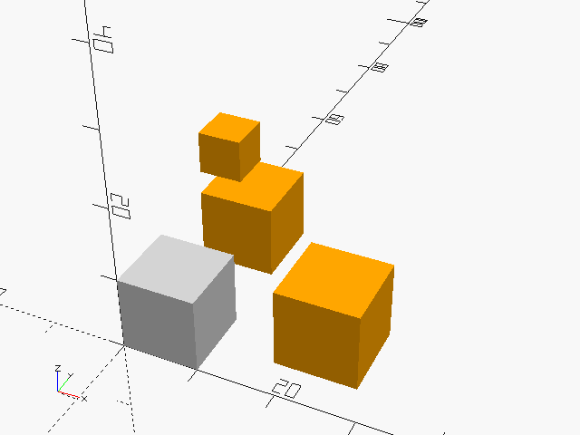

### `red()` / `green()` / `blue()` / `white()` / `black()`

Kurzform für `color("…") children();`.

```openscad
red() cube(10);
```

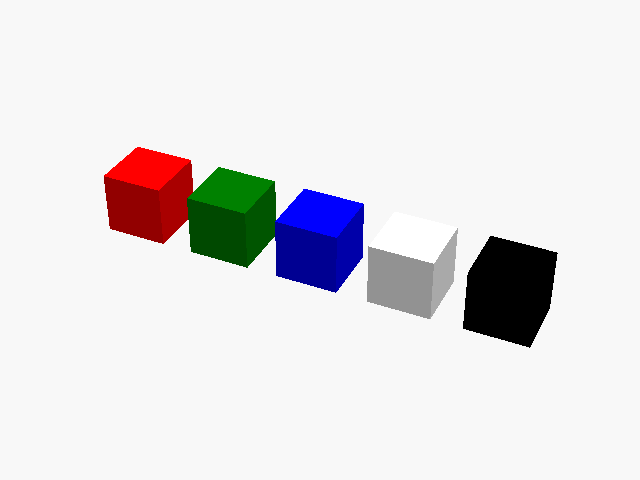

### `rx(angle=90)` / `ry(angle=90)` / `rz(angle=90)`

Drehung um eine Achse: `rx(a)` = `rotate([a,0,0])`, `ry(a)` = `rotate([0,a,0])`, `rz(a)` = `rotate([0,0,a])`.

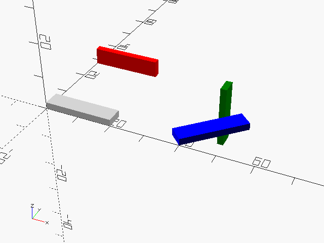

### `vier(x, y)`

Setzt die Kinder viermal an `(±x, ±y)` – z. B. für Befestigungslöcher in den Ecken.

```openscad
vier(15, 10) cylinder(d=5, h=8);
```

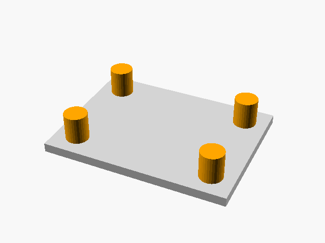

### `rotateMultiply(x=20, count=3)`

Verteilt die Kinder `count`-mal im Kreis mit Radius `x` um die Z-Achse.
(Hinweis: Die Schleife läuft `0..count`, die erste Kopie wird also doppelt erzeugt.)

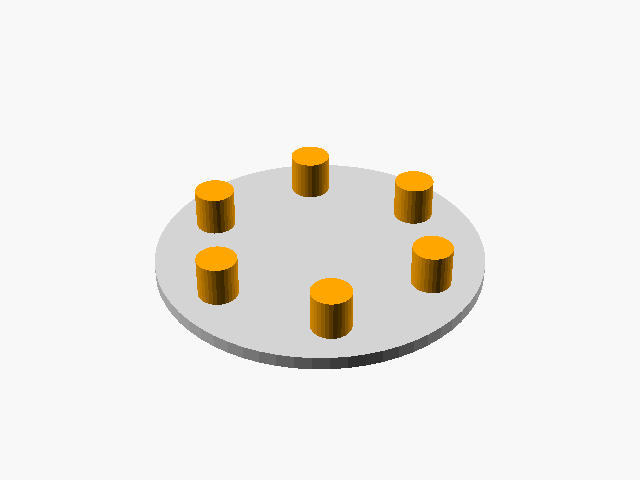

---

# Raster & Balken

Die globale Variable `r = 7.5` ist das Rastermaß.

### `raster(x, y, height=10, r_size=7.5)`

Erzeugt `x × y` M3-Zylinder (r = 1,5) im Rasterabstand – gedacht zum Abziehen mit `difference()`.

```openscad
difference() {
  cube([45, 30, 3]);
  move(3.75, 3.75, -5) raster(6, 4);
}
```

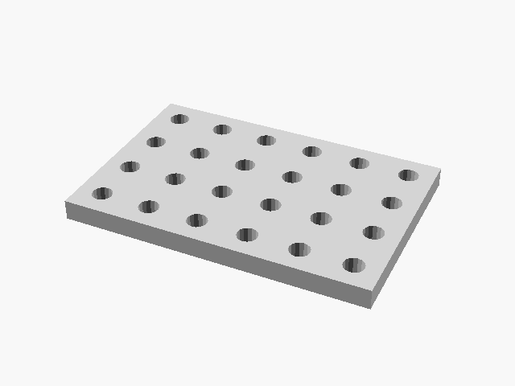

### `balken(steps, boden=0, xr=true, yr=true)`

Balken mit 7,5 × 7,5 mm Querschnitt und `steps` Rasterfeldern. Senkrechte Bohrungen sind immer vorhanden,
`yr` schaltet die Querbohrungen, `xr` die Längsbohrung. `boden` fügt eine Bodenplatte der angegebenen Dicke hinzu.

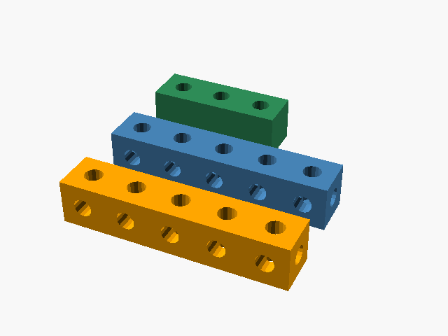

### `balkenZ(length=5, xr=true, yr=true, boden=0)`

Stapelt `length` Balken-Elemente senkrecht (Säule).

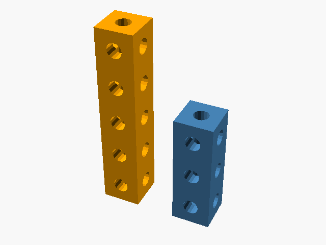

### `erweiterung2xZ(length=2, w=7.5)`

Rasterelement-Säule aus `length` Elementen, die auf einer dreieckigen Stütze (15 mm hoch) sitzt – zum seitlichen Anbauen in Z-Richtung.

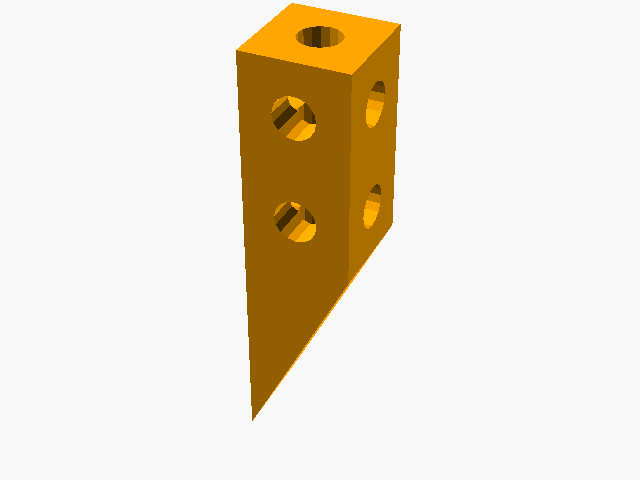

### `zoverhang(width=7.5)`

45°-Keil (7,5 × 7,5 mm) als druckbarer Überhang an einem Rasterelement.

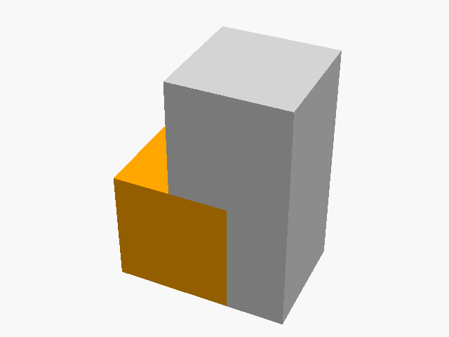

---

# Boxen & Halter

### `box(width, depth, height, raster_boden=true, wand=1)`

Offene Wanne mit Boden und zwei Längswänden, jeweils mit Lochraster.

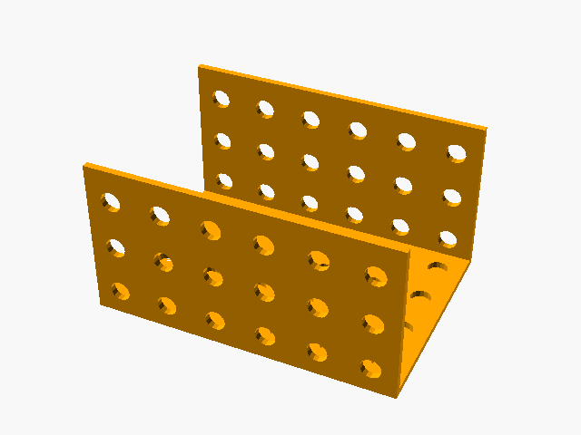

### `akkubox_18650_1x4(height=22, cells=3, boden_aussparung=true, boden=true, anschluss=true)`

Halter für `cells` 18650-Akkus nebeneinander, mit Rasterlöchern in den Ecken, optionaler Bodenaussparung und Kabeldurchführung (`anschluss`).

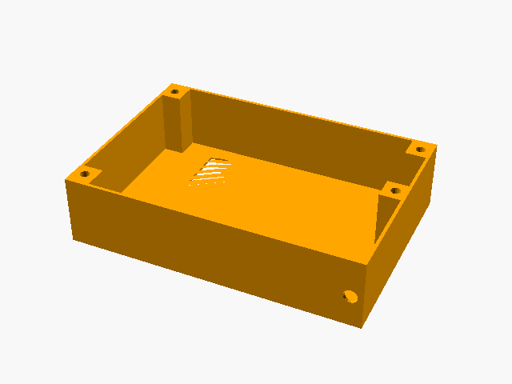

### `arca_plate(top_height=3, length=5, raster=true)`

Arca-Swiss-kompatible Schwalbenschwanz-Platte mit Länge `length` (Extrusion in Z) und M3-Löchern.

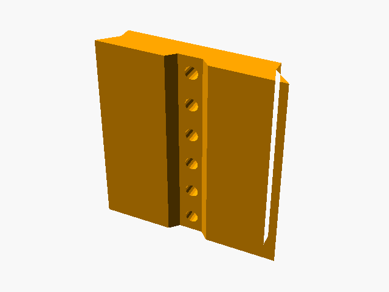

### `arca_aufnehmer(length=105, raster=true, rand=true, aufrastern=true, feststeller=true, festhalter=true)`

Gegenstück zur Arca-Platte (Klemme/Aufnahme) mit Rasterbohrungen, Seitenrändern und optionalem Feststeller mit M3-Mutter.

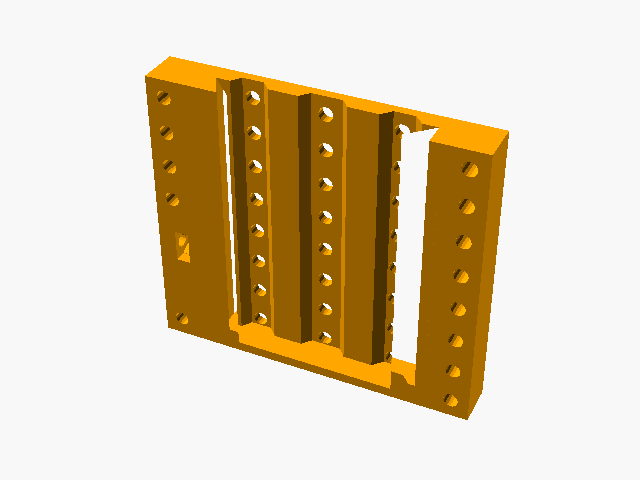

### `abdeckung(x=30, y=60)` / `abdeckung_einschub(x=30, y=60, wand=1.75)`

Platte (4 mm) mit trapezförmiger Schiebeführung und der passende Einschub-Deckel mit Rastnase.

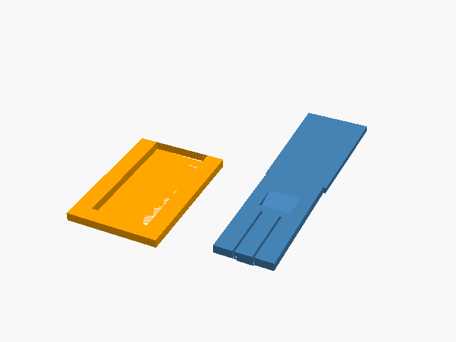

---

# Grundformen

### `cubec(x=10, y=10, z=7.5)` / `cubex(x=10, y=10, z=7.5)` / `cube_rounded(x, y, z, r=2)`

- `cubec` – Quader, in X und Y zentriert (Z ab 0)
- `cubex` – Quader, nur in X zentriert
- `cube_rounded` – Quader mit abgerundeten senkrechten Kanten (Radius `r`), Ecke im Ursprung

Im Bild markiert der rote Stab jeweils den Ursprung des Objekts (orange = normaler `cube`).

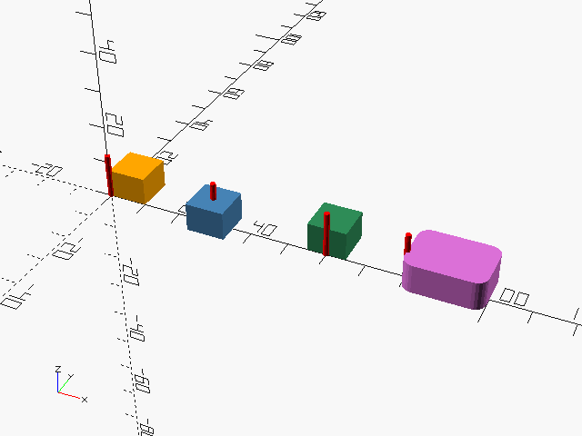

### `ring(d=55, thickness=5, h=5)`

Ring mit Außendurchmesser `d`; der Innendurchmesser ist `d - thickness`.

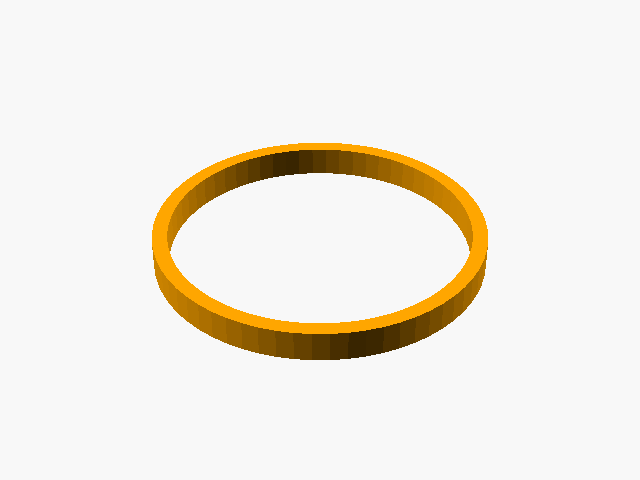

### `trapez(x1, x2, y, z)`

Trapez mit Grundseite `x1` und Oberseite `x2` im Abstand `y`, um `z` extrudiert.
(In der Datei ist `trapez` zweimal definiert – OpenSCAD verwendet die **letzte** Definition, die hier beschrieben ist.)

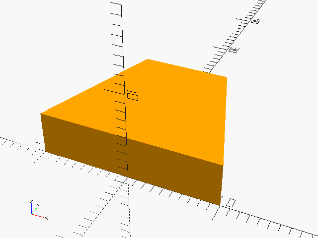

### `dreieckN(x=10, y=5, z=20)` / `dreieckP(x=10, y=5, z=20)`

Stehende rechtwinklige Keile (Spitze unten, Breite `x` oben in Höhe `z`, Dicke `y`) – z. B. als Stütze unter Überhängen. `N` und `P` sind spiegelbildlich (Schräge auf der linken bzw. rechten Seite).

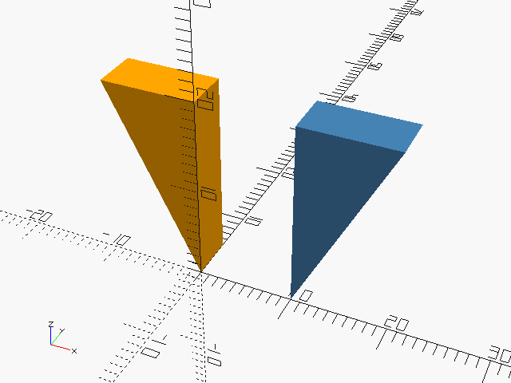

### `schamier(h=0)`

Scharnier-Auge (7,5 mm breit) mit 3,2-mm-Achsbohrung; `h` hebt das Auge an.

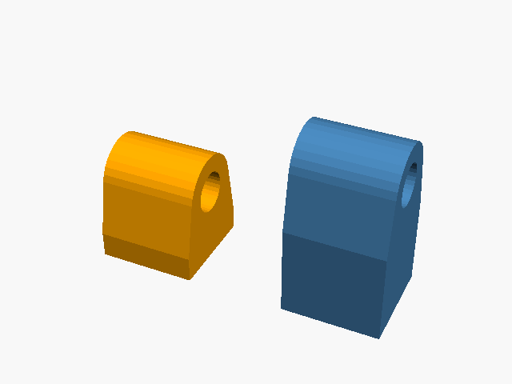

---

# Bohrungen & Muttern

### `m3hole(h=20, d=3)` / `m3holeX(h=20, r=1.5)` / `m3holeY(h=20, r=1.5)`

Zylinder zum Abziehen: `m3hole` senkrecht (startet bei z = -1), `m3holeX` entlang X, `m3holeY` entlang Y.

```openscad
difference() {
  cube([60, 30, 10]);
  move(10, 15) m3hole();
  move(-1, 7.5, 5) m3holeX(70);
}
```

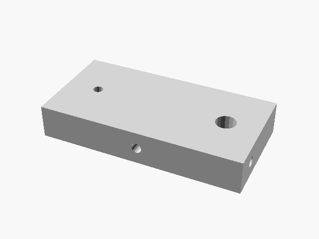

### `m3_nut(h=5)` / `m4_nut(h=3.5)` / `m6_nut(h=5.25)` / `m8_nut(h=8)` / `m_nut(sw=10, h=5)`

Sechskant-Aussparungen für Muttern (mit 0,05 mm Spiel); `m_nut` nimmt eine beliebige Schlüsselweite `sw`.

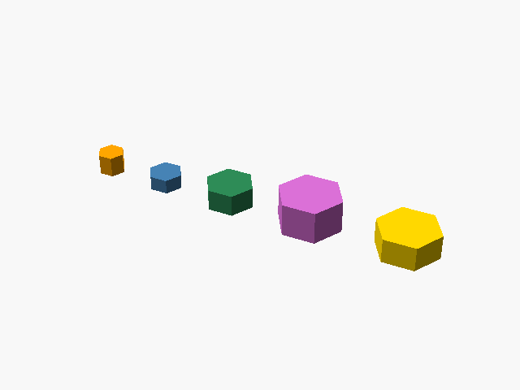

---

# Sonstiges

### `kranz(r15=false, r30=false, r30m8=false, r45m8=false)`

Lochkränze mit je 12 Löchern zum Abziehen:
`r15` M3 auf r = 15, `r30` M3 auf r = 30 inkl. 8-mm- und 20-mm-Löchern, `r30m8` 8 mm auf r = 30, `r45m8` 8 mm auf r = 45.

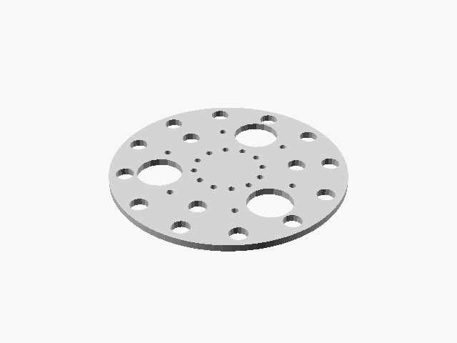

---

## Bilder neu erzeugen

```bash
cd examples
for f in *.scad; do openscad -o ../images/${f%.scad}.png --preview --viewall --autocenter --imgsize=640,480 --colorscheme=Tomorrow "$f"; done
```
